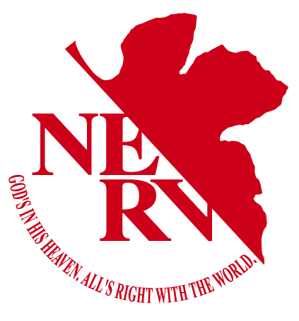

<div align="center">
    
    <h1>Nerv</h1>

[**Quick Start**](#quick-start) | [**Contributing**](#contributing) | [**License**](#license)

</div>

> [!IMPORTANT]
> Nerv is in early alpha and still in development; breaking bugs and missing features should be expected.

## Quick Start

A basic showcase is in the [**Showcase**](./example/hello.nerv) file.

Install Rust 1.94 or newer and your platform's native build tools (Xcode Command Line Tools on macOS, Visual Studio C++ Build Tools on Windows).

The official macOS LLVM archive also needs zstd (`brew install zstd`). On first use, the setup script prepares a shared LLVM library using the archive's bundled tools.

On macOS:

```sh
./nerv.sh example/hello.nerv
./time-release.sh --runs 5
```

On Windows:

```powershell
.\nerv.ps1 example\hello.nerv
.\time-release.ps1 -Runs 5
```

Both scripts reuse a compatible LLVM 23.1 installation, or download LLVM 23.1.3 into the repo's ignored `llvm/` folder and verify its SHA-256 checksum. The download is large and only needed once. Apple Silicon Macs and x64/ARM64 Windows have automatic downloads; Intel Macs require an existing LLVM 23.1 installation. Set `LLVM_SYS_231_PREFIX` or `LLVM_CONFIG_PATH` to use a custom installation. An unusable existing `llvm/` folder must be moved aside before downloading.

The macOS timing script requires Python 3. Use `--help` to see its options. Both timing scripts build and compare Nerv against the [Rust loop baseline](./time-release/) in `time-release/`. Use `--skip-rust-baseline` on macOS or `-SkipRustBaseline` on Windows to time only Nerv.

## Contributing

Contributions are welcome, but please make sure you clarify with me before submitting a pull request. You can contact me via my discord `non.menthol.newports`.

## License

Nerv is distributed under the [MIT](./LICENSE) license.
