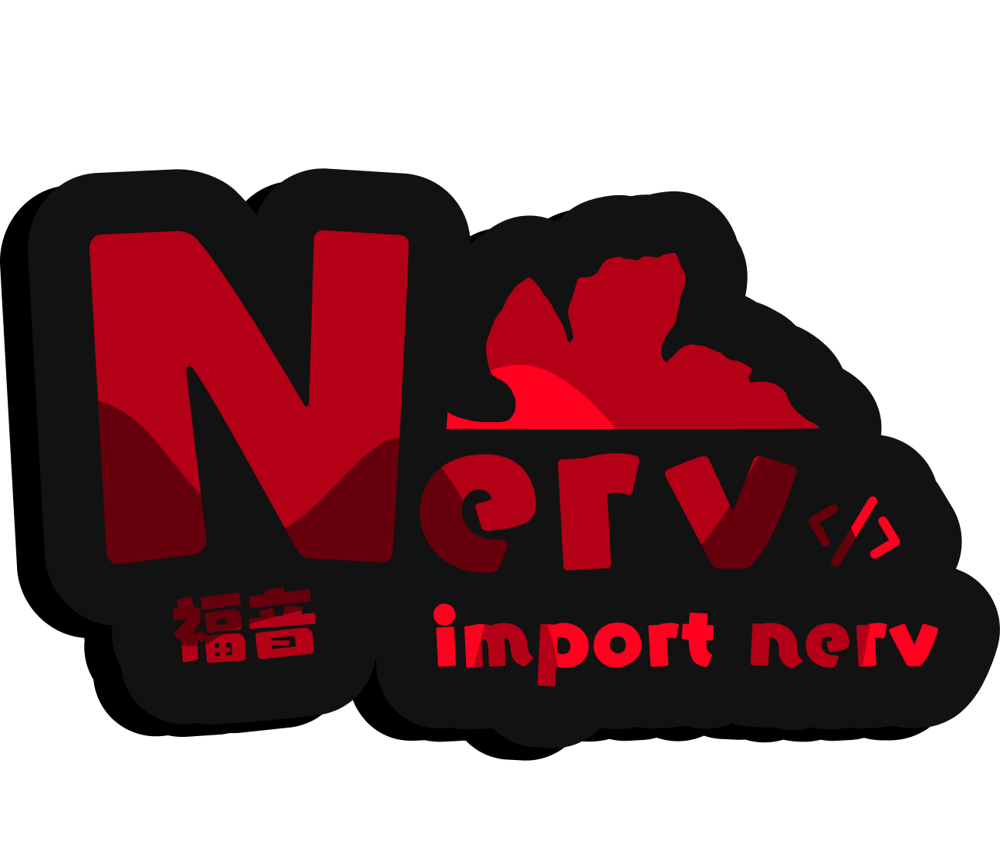

<div align="center">
    
    <h1>Nerv</h1>

[**Quick Start**](#quick-start) | [**Contributing**](#contributing) | [**License**](#license)

</div>

> [!IMPORTANT]
> Nerv is in early alpha and still in development; breaking bugs and missing features should be expected.

## Quick Start

A basic showcase is in the [**Showcase**](./example/hello.nerv) file.

The [language specification](./docs/language-spec.md) defines the supported alpha rules and includes executable examples and platform-specific instructions for running its conformance suite.

The [standard library](docs/standard-library.md) provides snapshot collections, growing buffers, string-keyed hash maps, text formatting/parsing, paths, structured I/O errors, allocation scopes, native tasks with cooperative cancellation, and process/time utilities through `import nerv.std`.

The current compiler supports content-based string equality, qualified module references, capturing closures, nested early returns, loop exits, and `Result`/`Option` propagation with `?`. These source-tree additions require rebuilding; older release archives do not include them.

The current source tree also provides [JSON, HTTPS, and WebSocket client APIs](docs/networking.md) through `import nerv.json` and `import nerv.net`. These additions require rebuilding the compiler; older release archives do not include them.

## Projects and installation

See [installation instructions](docs/installation.md) for downloads and source builds. The new distribution pipeline bundles the linker and target libraries, with Windows/macOS installers and portable downloads for Windows, macOS, and Linux. Native macOS/Linux validation is still pending. Older [alpha releases](https://github.com/NPSummers/Nerv-v2/releases) may require separately installed native build tools. Rust and Cargo are needed only to build the compiler.

```sh
nerv new hello
cd hello
nerv check --locked
nerv test --locked
nerv fmt --check
nerv run -- argument
nerv build --release --locked
```

See [project tooling](docs/projects.md) for `Nerv.toml`, local path dependencies, deterministic `Nerv.lock`, code-generation caching, formatting, and process exit codes. The repository launchers also forward project commands from the caller's current directory.

## Contributing

Contributions are welcome, but please make sure you clarify with me before submitting a pull request. You can contact me via my discord `non.menthol.newports`.

## License

Nerv is distributed under the [MIT](./LICENSE) license.
